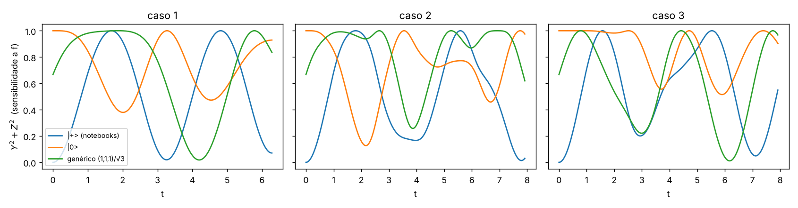
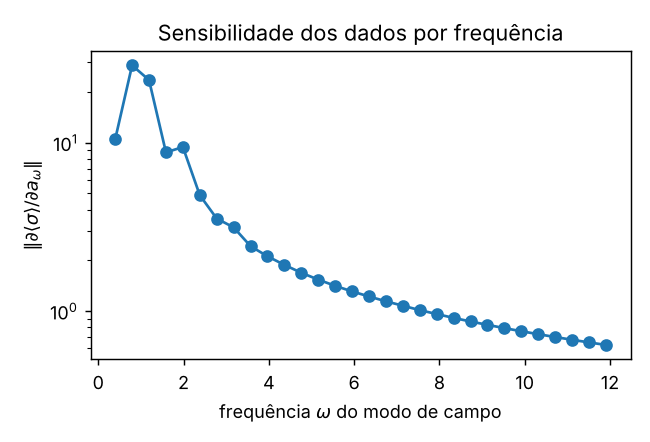
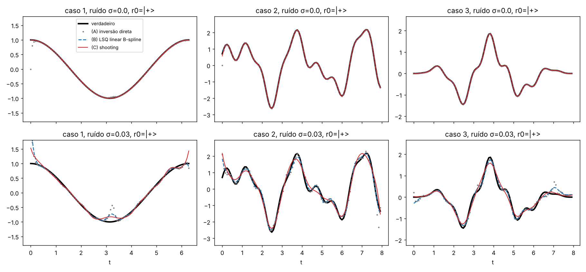
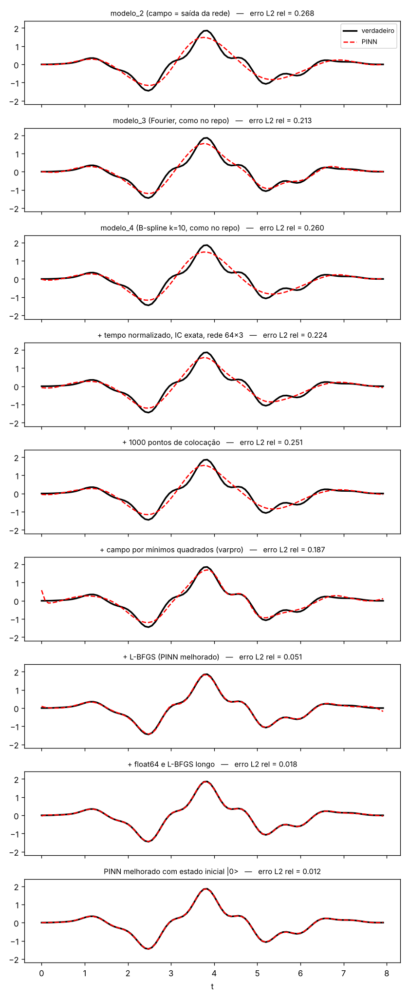

# Análise: por que os 4 métodos não dão bons resultados e o que testar

Problema estudado nos notebooks:

$$H(t) = \tfrac12\,\sigma_z + \tfrac12\, f(t)\,\sigma_x ,\qquad
\dot X=-Y,\quad \dot Y = X - fZ,\quad \dot Z = fY$$

com dados $\langle\sigma_x\rangle,\langle\sigma_y\rangle,\langle\sigma_z\rangle$ em N pontos e estado
inicial $|+\rangle$. Os 4 métodos (rede neural, Fourier, B-spline, MixFunn) diferem **só na
parametrização de f(t)**. O resto (rede para o estado + resíduo da EDO como penalidade + Adam) é
igual em todos.

Tudo nesta pasta roda em CPU, em minutos:

```bash
cd melhorias
python diagnostico.py          # observabilidade, capacidade das bases, sensibilidade (4 s)
python metodos_sem_pinn.py     # baselines sem PINN + desenho experimental (~1 min)
python pinn_melhorado.py --preset completo_f64 # PINN melhorado (~8 min)
python rodar_ablation.py --seeds 3             # ablation completo (~25 min, 4 núcleos)
python figura_pinn.py
```

---

## TL;DR

1. **A formulação pesa mais que a escolha da base.** Reproduzi os modelos 2, 3 e 4: os três
   convergem para **a mesma** solução suavizada (22–27 % de erro no campo 3, desvio < 1 % entre
   seeds). Com dados sem ruído, uma inversão **direta** (sem treino) ou um **mínimo quadrado
   linear** recuperam o mesmo campo com **0,2–0,6 % de erro em < 0,01 s**.
2. **O PINN dá para consertar:** tempo normalizado, IC exata, rede maior, colocação densa,
   campo resolvido em forma fechada (*variable projection*) e, principalmente, **L-BFGS em
   float64**. Com isso o erro cai de 22 % para **2,0 ± 0,3 %**, sem usar o campo verdadeiro nas
   bordas. O Adam sozinho para num platô que basta para a trajetória, mas não para o campo
   (seção 3.3).
3. **O estado inicial $|+\rangle$ é a pior escolha possível.** Ele é autoestado de $\sigma_x$, o
   operador do controle. Em t≈0 o campo não tem efeito nenhum sobre o estado, então ele não é
   identificável. Provavelmente é por isso que foi preciso "colar" `f(0)` e `f(T)` com os valores
   verdadeiros na loss.
   Com $|0\rangle$ (ou com vários estados iniciais) o problema fica bem posto. Com o mesmo
   orçamento de medidas e ruído, o erro cai **pela metade**. No PINN melhorado em float32, só
   trocar o estado inicial leva o erro de 4,5–22 % (conforme a seed) para 1,2–3,0 %.
4. **O mapa campo → dados é suavizante.** Componentes de alta frequência de f (o `0.4 sin 7t`)
   quase não mudam a trajetória: 26 % da norma do campo altera ⟨σ⟩ em só 0,047. Com ruído,
   regularização e desenho experimental passam a importar mais que a arquitetura.
5. **A comparação entre métodos hoje não é justa.** Cada método usa N, número de épocas,
   learning rate, regularização e condição de contorno diferentes, e só o caso 3 tem várias seeds.
6. **Bugs** encontrados (corrigidos neste branch): sinal errado no comutador da `Loss_EDO`
   (modelo_1), `MixFunn.forward` quebra com `N_layers=1`, caminhos de saída dos scripts `.py`
   apontam para pastas renomeadas, e `.gitgnore` com nome errado (por isso os `__pycache__`
   entravam no git).

---

## 1. Diagnóstico

### 1.1 Identificabilidade: f(t) só é visível quando o estado não está alinhado com σx

Das equações de Bloch, $fZ = X-\dot Y$ e $fY=\dot Z$. A informação sobre f em cada instante é
proporcional a $Y^2+Z^2 = 1-X^2$ (estado puro). Quando o vetor de Bloch aponta ao longo de x
(o eixo do controle), **qualquer** f gera os mesmos dados.



| caso | estado inicial | fração do tempo com $Y^2+Z^2<0{,}05$ | mínimo de $Y^2+Z^2$ |
|---|---|---|---|
| 1 | $\lvert+\rangle$ (notebooks) | 9 % | **0** (em t=0) |
| 1 | $\lvert 0\rangle$ | 0 % | 0,38 |
| 2 | $\lvert+\rangle$ | 7 % | **0** |
| 2 | $\lvert 0\rangle$ | 0 % | 0,13 |
| 3 | $\lvert+\rangle$ | 4 % | **0** |
| 3 | $\lvert 0\rangle$ | 0 % | 0,52 |

Consequências práticas:
- Nos scripts, `(JX[0]-Field(0))**2 + (JX[-1]-Field(T))**2` usa o **campo verdadeiro**. É uma
  "cola" que esconde exatamente essa falta de identificabilidade. Num problema inverso real
  f(0) não é conhecido. Se o pulso começa e termina em zero por construção, imponha isso de forma
  rígida (ex.: `f = sin²(πt/T)·g(t)` ou B-spline com coeficientes das bordas = 0) e diga isso no
  texto.
- **Sugestão:** gerar os dados a partir de $|0\rangle$, ou de vários estados iniciais
  ($|+\rangle, |0\rangle, |{+i}\rangle$) com o **mesmo** campo, e ajustar um único f a todos.
  O custo é zero e o problema fica bem condicionado em todo o intervalo (seção 3.2).

### 1.2 O problema é mal condicionado nas altas frequências

O campo entra em $\dot Z = fY$: o estado é uma **integral** do campo. Uma componente
$a\sin\omega t$ muda o estado em ~$a/\omega$:

| perturbação removida do campo 3 | fração da norma do campo | mudança máx em ⟨σ⟩ |
|---|---|---|
| `0.4 sin(7t)·env` | 26 % | **0,047** |
| `0.3 cos(3t−0.5)·env` | 20 % | 0,10 |
| `1.5 sin(2t)·env` | 98 % | 0,94 |



Isso explica a figura do PINN-Fourier: o campo recuperado é a versão suave do verdadeiro, mas a
re-simulação no qutip quase coincide com os dados. **Erro pequeno na trajetória não implica campo
correto.** O PINN precisa acertar as **derivadas** do estado com alta precisão, porque é nelas
que f aparece diretamente.

Sugestões:
- Reportar sempre **duas** métricas: erro L2 relativo do campo e RMSE da trajetória re-simulada.
- Estudar o erro em função da frequência: pegar um campo com componentes de frequência conhecida
  e medir até onde cada método recupera. Isso dá uma "resolução espectral" do método e é um
  resultado bom para artigo.

### 1.3 Capacidade das bases (ajuste supervisionado direto, sem física)

| base | caso 1 | caso 2 | caso 3 |
|---|---|---|---|
| Fourier M=10 (modelo_3) | 1e-15 | **13,5 %** (Gibbs: erro 0,75 em t≈0) | 0,5 % |
| Fourier M=20 | 1e-15 | 8,7 % | 0,006 % |
| Cossenos M=30 | 1e-15 | 1,7 % | 0,03 % |
| B-spline n=30, **k=10** (modelo_4) | 1e-14 | 1,1 % | 2,9 % |
| B-spline n=40, k=3 | 7e-7 | 0,2 % | 0,3 % |

- **Fourier com período T é periódica.** Se $f(0)\neq f(T)$ (caso 2) aparece o fenômeno de Gibbs.
  Use série de **cossenos** (extensão par, sem descontinuidade), Chebyshev/Legendre ou B-spline.
- **B-spline de grau 10 não é recomendada:** é mal condicionada e menos precisa que a cúbica com o
  mesmo número de parâmetros. Use k=3 (ou 5) e aumente n. Controle a suavidade pela penalidade de
  segunda diferença.
- Para o campo 3, Fourier M=10 já representa o campo com 0,5 %. **O erro de ~20 % do PINN-Fourier
  não vem da base, vem do treino.**

### 1.4 Problemas do treino PINN (comuns aos 4 métodos)

O ablation da seção 3.3 mede cada item. Sozinhos, quase todos têm efeito **pequeno** enquanto o
otimizador for só Adam. O que mais pesa é otimizar até o fim (L-BFGS em float64) e o estado
inicial.

| problema | onde | efeito | sugestão |
|---|---|---|---|
| entrada t ∈ [0, 7.9] sem normalizar | todos | `sin` com pesos ~U(−1,1): viés espectral forte, a rede pequena não representa os detalhes de alta frequência do estado | entrada `s = 2t/T − 1` |
| rede do estado muito pequena ([5,5], [15,15]) | todos | as derivadas do estado ficam imprecisas, e f = (X−Ẏ)/Z herda o erro | 3×64 (ou Fourier features) |
| resíduo da EDO só nos N pontos de dados | todos | a física é imposta em poucos pontos | colocação densa (1000+ pontos) independente dos dados |
| condição inicial "mole" (via loss de dados) | todos | deriva em t≈0, onde f já é pouco identificável | IC exata: `r(t) = r0 + (t/T)·NN(t)` |
| coeficientes iniciados com `tc.rand` (todos positivos) | Fourier | campo inicial grande e enviesado | iniciar com zeros ou pelo LSQ linear |
| `weight_decay` nos coeficientes do campo | Fourier, B-spline | encolhe o campo | remover ou usar regularização explícita de suavidade |
| Adam com lr fixo, sem refinamento, float32 | todos | o platô final é alto (**maior efeito medido**) | scheduler + **L-BFGS em float64** no final |
| pesos das losses = 1 fixos | todos | desbalanceio entre dados e EDO | pesos adaptativos (ex.: NTK / gradient-norm) ou varpro (abaixo) |
| estado e campo otimizados juntos por Adam | Fourier, B-spline | acoplamento ruim, convergência lenta | **variable projection** (abaixo) |

**Variable projection (varpro).** Para f = B·c (Fourier, B-spline, cossenos), com o estado fixo o
resíduo da EDO é **linear** em c:

$$\min_c \;\|Z\odot Bc-(X-\dot Y)\|^2 + \|Y\odot Bc-\dot Z\|^2 + \lambda\|D_2c\|^2$$

Isso tem solução fechada (um `linalg.solve` de 40×40). Em cada iteração resolve-se c exatamente a
partir do estado atual da rede, e o Adam só otimiza a rede do estado. Está implementado em
`pinn_melhorado.py` (`varpro=True`).

---

## 2. Bugs encontrados (corrigidos neste branch)

1. **`modelo_1/main/function.py::Loss_EDO` – sinal errado.**
   $-i[H,\rho]$ tem parte real $[H_r,\rho_i] + [H_i,\rho_r]$. O código tinha `−`.
   Testado numericamente: para H=σx o erro é 0 (H real), para H=σy o erro é 0,57. Qualquer
   Hamiltoniano com σy (ou acoplamentos XY, como nos casos de 2–3 qubits, se reaproveitarem essa
   função) era resolvido errado.
2. **`modelo_1/solver_Htime_example1.ipynb`**: em `data()` o qutip usa `H0 = B0*sx` (com o
   comentário "TROCAR POR sz"), mas a matriz `H_t` passada para a PINN usa `B0*sz`. Os dados e a
   física da loss são de Hamiltonianos diferentes. *(Não alterei o notebook; vale corrigir.)*
   Em `main/function.py::data()` com `state=True`, `result` não é definido (o `sesolve` está
   comentado).
3. **`Modelo_5(Mixfunn)/mixfunn.py::MixFunn.forward`**: `x = self.layers2(x)` estava fora do
   `else`, e com `N_layers=1` dá `AttributeError` (a cópia em `5_niveis/` já estava certa).
4. **Caminhos de saída**: `fourier_pinn_field_3.py` e `mixfunn_pinn_field_3.py` salvavam em
   `modelo 3(Fourier)/…` e `Modelo 5(Mixfunn)/…`, pastas que foram renomeadas com `_`. Os scripts
   quebravam no `savefig`.
5. **`.gitgnore` → `.gitignore`**: com o nome errado o git ignorava o arquivo, e por isso os
   `__pycache__/*.pyc` entravam nos commits. Renomeado e `.pyc` removidos do índice.

Observação menor: nos dados do qutip o campo é passado como **array** (`[H1, field(tlist)]`), e o
qutip interpola com spline. Em relação ao campo analítico a diferença é ~1e-5 (medido), o que é
desprezível aqui. Com N pequeno ou campos rápidos, prefira passar a função `lambda t: f(t)`.

---

## 3. Resultados dos experimentos

### 3.1 Métodos sem PINN (N = 100 pontos, campo de cada caso)

(A) inversão direta ponto a ponto · (B) mínimos quadrados lineares nos coeficientes
(B-spline n=40 ou Fourier M=10) · (C) *shooting*: simula a equação de Bloch (RK4 + sensibilidades)
e ajusta c por Levenberg–Marquardt. A dinâmica é satisfeita **exatamente**.

Erro L2 relativo do campo (tabela completa em `resultados_sem_pinn.csv`):

| caso | r0 | ruído σ | (A) direta | (B) LSQ B-spline | (B) LSQ Fourier10 | (C) shooting |
|---|---|---|---|---|---|---|
| 1 | \|+⟩ | 0 | 14 % (t≈0) | 0,07 % | 0,00 % | 0,04 % |
| 1 | \|0⟩ | 0 | 0,13 % | 0,00 % | 0,00 % | 0,00 % |
| 2 | \|+⟩ | 0 | 5,8 % | 1,4 % | **17 %** (Gibbs) | 1,1 % |
| 2 | \|0⟩ | 0 | 0,30 % | 0,24 % | 16 % | 0,22 % |
| 3 | \|+⟩ | 0 | 0,22 % | 0,30 % | 0,64 % | 0,28 % |
| 3 | \|0⟩ | 0 | 0,16 % | 0,28 % | 0,49 % | 0,28 % |
| 3 | \|+⟩ | 0,01 | 9,5 % | 7,6 % | 6,2 % | 6,0 % |
| 3 | \|0⟩ | 0,01 | 7,1 % | 6,2 % | 3,7 % | 6,9 % |
| 3 | \|+⟩ | 0,03 | 20 % | 18 % | 16 % | 18 % |
| 3 | \|0⟩ | 0,03 | 14 % | 13 % | 10 % | 18 % |

Tempo: (A) e (B) < 0,15 s, (C) < 1 s.



Observações:
- Sem ruído, (B) e (C) chegam a ~0,3 % no caso 3. **Este é o patamar que um PINN deveria
  alcançar.** Se não alcança, o problema é otimização ou formulação, não física.
- O *shooting* partindo de c=0 cai num **mínimo local** no caso 1 com |0⟩ (erro 900 %). Partindo
  da solução do LSQ linear (warm start) converge para 0,00 %. Use (B) como inicialização de
  qualquer método iterativo, incluindo os PINNs.
- Com ruído os erros se concentram onde $Y^2+Z^2\to0$ (t≈0 e t≈π no caso 1, com |+⟩). É a
  identificabilidade da seção 1.1 aparecendo.
- Com ruído, a escolha de λ domina. Aqui usei λ fixo (1e-3 para σ=0,01 e 1e-2 para σ=0,03).
  Testei o princípio da discrepância e não melhorou. Vale testar L-curve ou validação cruzada
  (deixar pontos de fora).

### 3.2 Desenho experimental com orçamento fixo de medidas (caso 3)

Mesmo número total de shots em todas as linhas: ao dividir o orçamento em mais pontos ou mais
estados, o ruído por ponto cresce com √(nº de pontos). Média de 5 realizações de ruído:

| desenho | σ por ponto | LSQ (σ_ref=0,01) | shooting (σ_ref=0,01) | LSQ (σ_ref=0,03) | shooting (σ_ref=0,03) |
|---|---|---|---|---|---|
| 1 estado \|+⟩, N=100 (atual) | σ | 0,153 ± 0,053 | 0,093 ± 0,010 | 0,311 ± 0,151 | 0,225 ± 0,018 |
| 1 estado **\|0⟩**, N=100 | σ | **0,069 ± 0,008** | **0,067 ± 0,005** | **0,151 ± 0,023** | 0,194 ± 0,012 |
| 1 estado \|+⟩, N=300 | 1,7σ | 0,190 ± 0,062 | 0,073 ± 0,010 | 0,245 ± 0,087 | 0,198 ± 0,027 |
| **3 estados** \|+⟩,\|0⟩,\|+i⟩, N=100 | 1,7σ | 0,073 ± 0,012 | 0,069 ± 0,015 | 0,158 ± 0,020 | **0,151 ± 0,031** |

Trocar o estado inicial custa nada e reduz o erro pela metade, além de diminuir muito a
variância entre realizações.

### 3.3 PINN: ablation das melhorias (caso 3, N=100, |+⟩, sem ruído, 3 seeds)

`pinn_melhorado.py`, cada linha acrescenta uma melhoria à anterior. As três primeiras linhas
são réplicas dos scripts do repositório (mesma rede, lr, épocas, BC). Dados em
`resultados_pinn/ablation_v2.json` (e `ablation_v1_bug_lbfgs.json` para as linhas sem L-BFGS).

| configuração | erro L2 do campo | RMSE re-sim | tempo/seed |
|---|---|---|---|
| modelo_2 original (campo = 4ª saída da rede, [15,15], 50k Adam, BC verdadeira) | 26,7 ± 0,2 % | 1,2e-2 | 1,5 min |
| modelo_3 original (Fourier M=10, 100k Adam, BC verdadeira) | 22,3 ± 0,8 % | 9,4e-3 | 3 min |
| modelo_4 original (B-spline n=30 k=10, 100k Adam) | 26,0 ± 0,0 % | 1,1e-2 | 3 min |
| *MixFunn (resultados salvos no repo, N=200, BC verdadeira, 5 seeds)* | *5,4 ± 1,8 %* | – | – |
| tempo normalizado + IC exata + rede 3×64 + scheduler, **sem** BC verdadeira (30k Adam) | 23,1 ± 1,0 % | 9,9e-3 | 2 min |
| + 1000 pontos de colocação | 22,1 ± 2,7 % | 9,5e-3 | 4 min |
| + varpro (campo B-spline n=40 resolvido em forma fechada) | 19,8 ± 1,8 % | 7,9e-3 | 4 min |
| + L-BFGS 2000 it. (float32) | 10,6 ± 8,2 % (seeds: 5,1 / 22 / 4,5 %) | 4,1e-3 | 4 min |
| **+ float64 e L-BFGS 8000 it.** | **2,0 ± 0,3 %** | 4,4e-4 | 8 min |
| L-BFGS float32, mas com estado inicial **\|0⟩** | 2,2 ± 0,7 % | 8,1e-4 | 4 min |
| L-BFGS float32, ruído σ=0,01 | 16,8 ± 4,5 % | 7,3e-3 | 4 min |
| *referência: LSQ linear / shooting (seção 3.1)* | *0,30 % / 0,28 %* | *4e-5* | *< 1 s* |



O que os números dizem:
- **Os três PINNs originais convergem para a mesma resposta suavizada** (22–27 %, com desvio
  entre seeds < 1 %). O erro é sistemático e não depende da base: Fourier, B-spline e rede caem
  no mesmo lugar. Isso confirma que o gargalo é a formulação e a otimização, não a parametrização
  do campo. É por isso que trocar de método não estava ajudando.
- **As melhorias de arquitetura, sozinhas, quase não mudam nada** enquanto o otimizador for só
  Adam: 22 % → 20 %. O ganho grande vem de **otimizar até o fim**: L-BFGS e, principalmente,
  **float64**. Em float32 o L-BFGS não deu nenhum passo útil em 1 de 3 seeds (resultado idêntico
  ao do Adam), o que deu 22 % nessa seed. Em float64 isso não aconteceu.
  - Com varpro, a loss precisa conter **o mesmo** termo λ‖D₂c‖² que o solve fechado minimiza,
    senão o gradiente usado pelo L-BFGS é inexato. Corrigi isso no script, mas a seed que
    travava em float32 continuou travando, então a causa principal é a precisão numérica.
- **O mecanismo:** no platô do Adam a loss de dados fica em ~3e-4 (erro RMS ≈ 0,01 por
  componente de ⟨σ⟩) em **todos** os PINNs originais. Isso é da mesma ordem da assinatura que
  as componentes rápidas do campo deixam na trajetória (≤ 0,05, seção 1.2). A rede "prefere"
  um campo suave com a trajetória levemente errada. Depois do L-BFGS em float64, a loss de dados
  cai para ~5e-7 e o campo aparece. Regra prática: **só confie no campo quando o erro de ajuste
  dos dados for bem menor que o efeito que você quer resolver** (ou chegar no nível do ruído).
  Um teste barato que não fiz: aumentar o peso da loss de dados (`w_data` = 10–100).
- **Trocar |+⟩ por |0⟩** dá, sem custo, quase o mesmo ganho que float64 + L-BFGS longo: com a
  mesma configuração float32, 2,2 ± 0,7 % contra 5,1 / 22 / 4,5 % com |+⟩. Com |0⟩ nenhuma seed
  travou.
- O PINN melhorado (2 %) supera o melhor do repositório (MixFunn, 5,4 %) **sem** usar o campo
  verdadeiro nas bordas e com metade dos pontos. Mesmo assim fica ~7× pior que o LSQ linear e
  milhares de vezes mais lento (minutos vs. < 1 s). **Com ruído**, o PINN (17 %) fica pior que
  os baselines (6–8 %): ele não tem regularização explícita ajustada ao nível de ruído.

---

## 4. O que testar, em ordem de prioridade

1. **Protocolo de comparação único** para os 4 métodos (+ os baselines da seção 3.1):
   mesmo N, mesmos dados, mesmo orçamento de épocas, sem usar f verdadeiro na loss,
   ≥ 5 seeds, métricas = erro L2 do campo + RMSE da re-simulação + tempo. Hoje só o MixFunn e o
   Fourier têm várias seeds, com N diferentes (200 e 100).
2. **Incluir os baselines não-PINN** na comparação (inversão direta, LSQ linear, shooting). Um
   revisor vai perguntar por que usar PINN se um mínimo quadrado resolve. A resposta honesta é
   onde o PINN pode ganhar: dados **parciais** (ex.: só ⟨σz⟩), ruído alto, sistemas maiores e
   sistemas abertos (Lindblad). É aí que vale testar.
3. **Mudar o estado inicial** (|0⟩) ou usar **vários estados iniciais** e tirar a "cola"
   `f(0)=f_true(0)` / `f(T)=f_true(T)`.
4. **Melhorias do PINN** (seção 1.4): em ordem de impacto medido, **L-BFGS em float64** no
   final, entrada normalizada, IC exata, rede maior, colocação densa e, para bases lineares,
   **variable projection**. Rodar `python pinn_melhorado.py --preset completo_f64`.
5. **Bases**: B-spline cúbica (n≈40) com penalidade de 2ª diferença, ou série de cossenos, no
   lugar de Fourier periódica / B-spline grau 10. Inicializar os coeficientes pelo LSQ linear.
6. **Ruído realista** (shot noise binomial: $\sigma \approx \sqrt{(1-\langle\sigma\rangle^2)/N_{shots}}$)
   e **seleção de λ** (L-curve, validação cruzada). Sem ruído o problema é "fácil demais" e não
   diferencia os métodos.
7. **Dados parciais**: medir só ⟨σz⟩ (ou só ⟨σx⟩, ⟨σz⟩). Aqui a inversão direta não funciona
   e PINN/shooting mostram vantagem real. É um caso mais interessante para publicar.
8. **Shooting/neural-ODE** como 5º método: `qutip_control_jax.py` / `qutip_control_flax.py` já
   começam isso. Em vez de uma NN dentro do `mesolve` (lento), parametrize f por B-spline
   (40 parâmetros) e use Gauss-Newton/LM, como em `metodos_sem_pinn.py`. Para 2–3 qubits isso
   continua barato, porque o Jacobiano tem só nb colunas.
9. **Resolução espectral**: medir o erro por banda de frequência (FFT do erro) para entender o
   limite de cada método (seção 1.2).

---

## 5. Arquivos desta pasta

| arquivo | conteúdo |
|---|---|
| `common.py` | geração de dados (Bloch/scipy, confere com qutip em 1e-5), bases (Fourier, cossenos, B-spline), métricas |
| `diagnostico.py` | observabilidade, capacidade das bases, sensibilidade por frequência |
| `metodos_sem_pinn.py` | inversão direta, LSQ linear, shooting (multi-estado), estudo de desenho experimental |
| `pinn_melhorado.py` | PINN com cada melhoria ligável (`--preset`), réplicas dos modelos originais |
| `rodar_ablation.py` | roda presets × seeds em paralelo → `resultados_pinn/*.json` (`--presets`, `--out`) |
| `figura_pinn.py` | figura do ablation |
